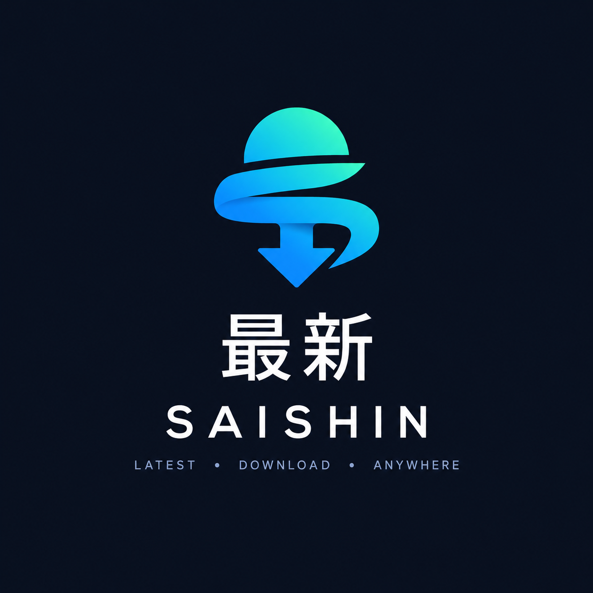

<div align="center">



# Saishin — 最新

</div>

A small cross-platform Rust command line tool that keeps files up to date from
official GitHub releases/actions — or from any other URL — using an INI configuration file.

It runs on **Windows, macOS and Linux** from the same source, downloads release
assets, and can unpack ZIP archives according to per-source rules.

It also handles sources that need a GitHub account: you authenticate **once**, the
token goes into your operating system's secure credential store, and later runs —
including scheduled ones — reuse it without ever prompting again.

---

## Contents

- [Requirements](#requirements)
- [Build and run](#build-and-run)
- [Version and releases](#version-and-releases)
- [Quick start](#quick-start)
- [Authentication](#authentication)
- [Scheduled runs](#scheduled-runs)
- [Configuration reference](#configuration-reference)
- [Archive handling](#archive-handling)
- [Glob patterns](#glob-patterns)
- [Command line options](#command-line-options)
- [Exit codes](#exit-codes)
- [Project layout](#project-layout)
- [Third-party components](#third-party-components)

---

## Requirements

- [Rust toolchain](https://rustup.rs/) (stable). Install via `rustup`, then
  the `cargo` command below just works.

Nothing else on Windows and macOS. There is no dependency on Windows-only APIs
or on platform-specific tooling.

On Linux, the GUI needs system libraries at build time — D-Bus for the
keyring, OpenSSL for HTTPS, EGL/GLX for the renderer:

```bash
sudo apt-get install -y libdbus-1-dev libssl-dev pkg-config \
  libegl1-mesa-dev libgl1-mesa-dev libxkbcommon-dev libxkbcommon-x11-dev
```

Wayland support loads `libwayland` at runtime, so those headers are not needed.

The header of the GUI spells 最新 out as text beside the logo, and the app ships
no CJK font: eframe's system font fallback takes one from the machine. Windows
and macOS have one, on Linux install `fonts-noto-cjk` (Debian, Ubuntu) or
`google-noto-cjk-fonts` (Fedora). A machine without such a font gets the logo on
its own: the word is left out of the header rather than set in boxes.

---

## Build and run

```bash
git clone <this-repo>
cd saishin

cargo build --release
./target/release/saishin-cli --config saishin.ini
```

During development, `cargo run -- --config saishin.ini` builds (debug) and runs
in one step, and `cargo test` runs the test suite.

To target another platform, install its target once and cross-compile:

```bash
# Linux x64 (from any host with the target installed)
rustup target add x86_64-unknown-linux-gnu
cargo build --release --target x86_64-unknown-linux-gnu

# Windows x64
rustup target add x86_64-pc-windows-msvc
cargo build --release --target x86_64-pc-windows-msvc

# macOS arm64
rustup target add aarch64-apple-darwin
cargo build --release --target aarch64-apple-darwin
```

Replace the identifiers with `aarch64-unknown-linux-gnu`, `aarch64-pc-windows-msvc`
or `x86_64-apple-darwin` as needed. Both Windows executables embed
`saishin-png-icon-set/saishin.ico` (see `build.rs`). That .ico is generated
artwork and is not in the repository, so on a fresh checkout generate it first —
`python3 saishin-png-icon-set/make_saishin_ico.py` (needs Pillow) — otherwise
the build warns and produces an executable without an icon. The CI jobs that
ship a binary do generate it, and `scripts/check-icon.ps1` fails the run when
the icon did not end up in the executable.

### The two Windows files

A Windows download is two executables, and the difference is only in how the run
starts:

| File | Started from | What happens |
| --- | --- | --- |
| `saishin.exe` | a shortcut, a double-click, the taskbar | No console window at all. It starts `saishin-cli.exe` in the same directory, reads its text, and puts that report in a message box. |
| `saishin-cli.exe` | a terminal, a script, Task Scheduler | Prints as usual, the shell waits for it, the exit code arrives. |

`saishin.exe` exists for one Windows detail. An icon launch of a console program
gets a console, and on a machine whose console host is Windows Terminal that is a
terminal window for a few hundred milliseconds, titled with the exe path, before
the GUI window opens. No call inside the process can stop the host from drawing
it; the PE subsystem is what decides whether a console exists in the first
place. So the launcher is marked as a GUI-subsystem binary, which is also the
binary carrying the icon, and it is std-only, so it starts in milliseconds.

What a run through the launcher reports:

- The box is for problems. A headless run's warnings and errors become the box;
  a run with nothing wrong says nothing, exits 0, and gets no box. A progress
  line and a source's log are not something to read in a dialog, so under a
  launcher they stay unprinted — a terminal run's transcript, and a script's or
  scheduled task's log, keep every line.
- A run that opens the GUI window prints nothing at all, warnings and errors
  included: the window is the report, and its lines are readable in the log
  strip at its bottom.
- The exit code is passed through, so watching exit codes changes nothing.

A terminal run of `saishin.exe` answers in a box rather than in the terminal, and
cmd and PowerShell do not wait for a GUI-subsystem program. In a script, call
`saishin-cli.exe`: it prints, and the shell waits for it.

On Linux and macOS there is no console window to avoid, so the program is all
there is, and it is called `saishin-cli` there as well.

---

## Version and releases

The version lives in exactly one place: `version` in `Cargo.toml`. Everything
else is derived from it at build time by `build.rs`.

```bash
./target/release/saishin-cli --version
saishin 1.0.0 (e88e2c3, x86_64-pc-windows-msvc, release)
```

That line names the version from `Cargo.toml`, the commit the binary was built
from (`-dirty` for a tree with uncommitted changes, `-ci` for a CI build), the
target triple and the profile. Nothing has to be kept in sync by hand.

### Every push

`.github/workflows/ci.yml` builds release binaries for Windows, Linux and
macOS, and uploads one artifact per platform, named
`saishin-<version>-<sha>-r<run>-<platform>-<arch>`. Downloading an artifact
gives a zip holding the executables and `saishin.ini.template` - on Windows the
launcher and the program, elsewhere the program alone - and the program's own
`-V` line names the same version and sha. The artifacts are on
the run page under **Artifacts**, which is the quickest way to get a build of a
branch: push, open the run, download. Dependency builds are cached per
`Cargo.lock`, so a push that changes no dependency reuses them.

### Making a release

1. Bump the version, commit it and tag it, in one command:

   ```powershell
   pwsh scripts/release.ps1 1.1.0
   ```

   The script refuses a dirty tree and a malformed version, updates
   `Cargo.toml` and `Cargo.lock`, commits `Release v1.1.0` and tags it
   `v1.1.0`. A prerelease label is allowed too (`1.1.0-rc1`).

2. Publish:

   ```bash
   git push main --follow-tags
   ```

`.github/workflows/release.yml` runs on any `v*` tag. It first checks that the
tag matches the version in `Cargo.toml`, and fails with a message saying so
when it does not, so a binary can never claim a version it is not. Then it
builds all three platforms and publishes a GitHub Release with one bundle per
platform:

```
saishin-1.1.0-x86_64-pc-windows-msvc.zip
saishin-1.1.0-x86_64-unknown-linux-gnu.tar.gz
saishin-1.1.0-aarch64-apple-darwin.tar.gz
```

Each bundle contains the binaries, `saishin.ini.template` and this README. The
release notes are generated from the changes since the last release, and the
new release is marked as the latest.

A published tag can be taken back:

```bash
git tag -d v1.1.0 && git push main :refs/tags/v1.1.0
```

then delete the release on the Releases page and run the script again with
the version you meant.

---

## Quick start

1. Copy the example configuration and edit it:

   ```bash
   cp saishin.ini.template saishin.ini
   ```

2. Check what would happen without downloading anything:

   ```bash
   ./target/release/saishin-cli --config saishin.ini --dry-run
   ```

3. Run it:

   ```bash
   ./target/release/saishin-cli --config saishin.ini
   ```

Start with `--help` for the full option list.

---

## Authentication

Public GitHub releases need no credentials. Sources that are account-gated — a
private repository, or builds published only to signed-in accounts — set
`private = true`, and then a token is required.

The token is a GitHub **personal access token** with the `repo` scope. Create one at
<https://github.com/settings/tokens>.

```bash
./target/release/saishin-cli --login
```

You are prompted once, the token is verified against the GitHub API, and it is then
written to the platform's credential store:

| Platform | Stored in |
| --- | --- |
| Windows | Credential Manager (via the Windows keychain API) |
| macOS | Keychain |
| Linux | Secret Service / GNOME Keyring, KWallet |

Remove it again with:

```bash
./target/release/saishin-cli --logout
```

### Where the token is looked up

In order:

1. Environment variables `SAISHIN_TOKEN`, `GITHUB_TOKEN` or `GH_TOKEN`.
   Useful for CI, where no keyring is available.
2. The OS secure store, as written by `--login`.
3. Otherwise, if any selected source is `private = true`, an interactive prompt.

The token is never written to the INI file, never logged, and never included in a
`.part` file. If you prefer not to use the keyring at all, export `GITHUB_TOKEN`
from your scheduler and `--login` becomes unnecessary.

---

## Scheduled runs

Scheduled runs must never block on a prompt, so pass `--non-interactive`. The tool
will then either reuse the stored token or fail with exit code `3` and a message
telling you to run `--login` once.

```bash
saishin-cli --config /etc/saishin/saishin.ini --non-interactive
```

### Linux (cron)

```cron
17 */6 * * * /usr/local/bin/saishin-cli --config /etc/saishin/saishin.ini --non-interactive >> /var/log/saishin.log 2>&1
```

### Linux (systemd timer)

```ini
# /etc/systemd/system/saishin.service
[Unit]
Description=saishin

[Service]
Type=oneshot
ExecStart=/usr/local/bin/saishin-cli --config /etc/saishin/saishin.ini --non-interactive
```

```ini
# /etc/systemd/system/saishin.timer
[Unit]
Description=Run saishin every six hours

[Timer]
OnCalendar=*-*-* 00/6:17:00
Persistent=true

[Install]
WantedBy=timers.target
```

```bash
systemctl enable --now saishin.timer
```

Headless Linux servers usually have no keyring daemon, and the tool then reports
that no secure store is available and falls back to environment variables. Use
`SAISHIN_TOKEN` in a `EnvironmentFile` on those machines instead of `--login`.

### macOS (launchd)

```xml
<!-- ~/Library/LaunchAgents/com.saishin.plist -->
<?xml version="1.0" encoding="UTF-8"?>
<!DOCTYPE plist PUBLIC "-//Apple//DTD PLIST 1.0//EN"
  "http://www.apple.com/DTDs/PropertyList-1.0.dtd">
<plist version="1.0">
<dict>
  <key>Label</key>
  <string>com.saishin</string>
  <key>ProgramArguments</key>
  <array>
    <string>/usr/local/bin/saishin-cli</string>
    <string>--config</string>
    <string>/etc/saishin/saishin.ini</string>
    <string>--non-interactive</string>
  </array>
  <key>StartCalendarInterval</key>
  <dict><key>Hour</key><integer>6</integer></dict>
  <key>StandardOutPath</key>
  <string>/tmp/saishin.log</string>
  <key>StandardErrorPath</key>
  <string>/tmp/saishin.err</string>
</dict>
</plist>
```

### Windows (Task Scheduler)

```powershell
Register-ScheduledTask -TaskName saishin -Action (
  New-ScheduledTaskAction -Execute 'C:\tools\saishin-cli.exe' `
    -Argument '--config C:\saishin\saishin.ini --non-interactive'
) -Trigger (New-ScheduledTaskTrigger -Once -At (Get-Date).AddHours(6) `
    -RepetitionInterval (New-TimeSpan -Hours 6)) -RunLevel Limited
```

Run the interactive `--login` from a normal terminal first, as your user account.
Windows Credential Manager is per-user, so the scheduled task must run as the same
user.

---

## Configuration reference

Every section other than `[general]` is one source. Relative paths resolve against
the directory containing the INI file.

Values are read exactly as they are written: a backslash is a path separator, not
an escape character, so `out = C:\Saishin\tables` names that directory. (Earlier
builds ran the INI reader with escape processing on, which ate the backslash and
turned `C:\Saishin\tables` into `C:Saishinstables`. One backslash is correct; a
doubled `\\` now stays doubled, which Windows also accepts.)

### `[general]`

| Key | Default | Meaning |
| --- | --- | --- |
| `out_dir` | `downloads` | Default download directory for sources without their own `out` |
| `github_api_url` | `https://api.github.com` | API root; override for GitHub Enterprise |
| `keyring_service` | `saishin` | Label used for the token in the secure store |
| `notify` | `false` | One desktop notification per run, after all sources, listing downloaded files. Uses `powershell` (Windows), `osascript` (macOS), `notify-send` (Linux) |
| `gui` | `false` | Open the selection window instead of running headless. `--gui` and `--no-gui` on the command line win over this key |
| `close_on_finish` | `false` | `false` keeps the window open when the run ends, on its end state with an **OK** button, so the log strip stays readable. `true` closes the window as soon as the run ends. A run that leaves a half
downloaded file asks about it first, which keeps the window open |
| `releases` | `10` | How many recent releases, or workflow runs, the `--gui` version dropdown offers per artifact. A source may override it |
| `sound` | empty | Play this sound file after a run that downloaded something |
| `sound_player` | empty | Command used to play the sound; the file is appended as the last argument. Default: `afplay` (macOS), `ffplay` (Windows, Linux) |

### Common keys (every source)

| Key | Default | Meaning |
| --- | --- | --- |
| `type` | *(required)* | `github` or `url` |
| `out` | `out_dir` | Download directory for this source |
| `filters` | *(all)* | Comma-separated globs matched against the file name; a glob prefixed with `!` excludes matches |
| `changelog` | `false` | Write the release description to `<artifact>.txt` next to each downloaded file (github sources) |
| `version_suffix` | `false` | Rename downloads to `<stem>-<tag><ext>` so same-name artifacts keep one file per version (release tag, or run number for actions) |
| `releases` | `10` | Number of recent releases, or workflow runs, offered in the `--gui` version dropdown. Overrides `[general] releases` for this source |

### `type = github`

| Key | Default | Meaning |
| --- | --- | --- |
| `owner` | *(required)* | Repository owner or organisation |
| `repo` | *(required)* | Repository name |
| `tag` | `latest` | `latest`, `prerelease`, `all`, or an exact tag name |
| `private` | `false` | Requires a stored GitHub token |

`tag = latest` picks the most recent non-draft, non-prerelease release, matching
GitHub's own definition. `tag = prerelease` picks the newest prerelease, and an
exact tag name matches only that release. `tag = all` walks every non-draft
release, paginating in batches of 100 up to a cap of 1000 releases.

Downloaded GitHub files have their modification time set to the release publish
date (or the workflow run creation date for action artifacts), so `keep`
retention orders by that date rather than by download time.

### `type = actions`

| Key | Default | Meaning |
| --- | --- | --- |
| `owner` | *(required)* | Repository owner or organisation |
| `repo` | *(required)* | Repository name |
| `workflow` | *(all)* | Only runs of workflows whose name matches this glob: the `name:` at the top of the file (`CI` for `ci.yml`), and for a dispatched run its display title. Only completed, successful runs count |
| `runs` | `10` | How many recent runs of that workflow to walk |

Listing artifacts needs a token, so this type always uses the stored one. Each
run contributes its artifacts; `filters` match the **artifact name**, and the
downloaded file is that name plus `.zip` when it does not already end in `.zip`
— GitHub hands out an artifact as a zip named after it. Expired artifacts are
skipped. The timestamp a file's freshness is judged by is the run's creation
date.

```ini
[saishin_builds]
type = actions
owner = JockeJarre
repo = Saishin
workflow = CI
filters = *windows-x64*
out = ./builds/actions
```

### `type = url`

| Key | Default | Meaning |
| --- | --- | --- |
| `urls` | *(required)* | Comma-separated list of absolute URLs |

The file name is taken from the last segment of the URL path. These downloads are
compared with the server's reported content length, so a changed file is fetched
without needing `--force`.

### Lists

`filters`, `urls` and `extract` take comma-separated values on a single line:

```ini
filters = *.vpt, *.vpin, Tables/*
```

The INI parser collapses repeated keys to the last value, which is why lists are
written as one comma-separated line rather than repeated.

---

## Archive handling

`.zip` and `.vpt` files are treated as archives. Extraction happens only when a
source sets `extract`, so a source never unpacks anything by accident.

| Key | Default | Meaning |
| --- | --- | --- |
| `extract` | *(none)* | Comma-separated globs of entries to extract. Extraction is skipped entirely when absent |
| `extract_to` | `<out>/<section>` | Destination directory for the unpacked files |
| `strip_prefix` | `0` | Number of leading path segments to drop. Use `1` for archives that wrap everything in one folder |
| `overwrite` | `false` | Replace files that already exist. Otherwise existing files are left alone |
| `keep_zip` | `true` | Set to `false` to delete the archive once extraction finished |

Extraction is always safe against path traversal: entries that would escape the
destination directory, or that carry a `..` segment, are refused and reported as
warnings.

Example — drop the wrapper folder and keep only the tables:

```ini
[territory_tables]
type = github
owner = vpinball
repo = vpin-mame-tables
filters = *.vpt
out = ./downloads/tables
extract = *.vpt
extract_to = ./tables
strip_prefix = 1
overwrite = true
keep_zip = false
```

`--force` makes `--overwrite` unnecessary; it overrides both the download and the
extraction step.

---

## Glob patterns

Filters and `extract` accept these wildcards:

| Pattern | Matches |
| --- | --- |
| `*` | Any run of characters except `/` |
| `?` | Exactly one character except `/` |
| `**` | Any run of characters including `/` |

A pattern with no `/` is matched against the whole path and against the file name
alone, so `*.vpt` catches tables nested at any depth. Patterns containing `/` are
always matched against the full path.

Matching is case-insensitive on Windows and macOS and case-sensitive on Linux,
following normal filesystem expectations.

---

## Command line options

```
saishin [saishin.ini] [options]
```

| Option | Effect |
| --- | --- |
| `-c`, `--config <path>` | Configuration file. Defaults to `./saishin.ini`, then next to the executable |
| `-s`, `--source <name>` | Run only this source. Repeatable |
| `--dry-run` | Report what would be downloaded and extracted, download nothing |
| `-f`, `--force` | Re-download and overwrite even when a file is already current |
| `--non-interactive` | Never prompt. Fail with exit code `3` if credentials are missing |
| `--login` | Prompt for a token, verify it, store it, then exit |
| `--logout` | Remove the stored token, then exit |
| `--gui` | Show a selection window for new artifacts before downloading, with no console output |
| `--no-gui` | Run headless, ignoring `gui = true` in the configuration |
| `-q`, `--quiet` | Suppress progress and informational output |
| `-V`, `--version` | Print the version, commit, target and profile, then exit |
| `-h`, `--help` | Show usage |

The configuration path may also be given positionally, as in
`saishin-cli saishin.ini`. The default name is `saishin.ini`, the name of the
template in the download. A file still called `config.ini` from the earlier
examples works when it is passed with `--config`.

### GUI selection

```bash
./target/release/saishin-cli --config saishin.ini --gui
```

Instead of downloading every new artifact, `--gui` opens a window listing the
new artifacts — each with a checkbox (checked by default), a hyperlink to its
GitHub release, workflow run, or source page, and its size. Uncheck the ones
you do not want, then press **Download selected**. **Cancel** aborts the run;
**Select all** / **Select none** reset the checkboxes. Only the checked
artifacts are downloaded; the rest of the run (changelogs, archive handling,
notifications) proceeds as usual. The window needs a display server, so use
the plain CLI mode for headless scheduled runs.

The same front end can be chosen in the configuration, which is what a desktop
shortcut wants:

```ini
[general]
gui = true
```

A switch on the command line wins over the key, so the same configuration still
runs headless for one-off terminal work with `--no-gui`, and `--gui` opens the
window for a configuration that is headless by default.

A GUI run keeps the console out of it: the window carries the report, so nothing
is printed. That is not cosmetic. An exe of this kind is a console-subsystem
program, so launching it from a shortcut gives it a console, and text in that
console is what keeps a command window standing beside the selection window. The
console is released as the window opens, and the notification and sound commands
are started without a console of their own. Started from a terminal, `--gui`
therefore prints nothing while the window is open; `--no-gui` is the run that
writes text. A configuration that fails before any window can open still prints,
because then the console is the only report there is - and when even that
console closes with the process, which is what launching the exe from a shortcut
gives, the same words arrive in a box on the desktop.

The window opens as soon as the configuration and the token are settled, before
the sources are asked: a run of several sources takes seconds, and the window
shows **Checking sources...** with a spinner while they answer, and **Cancel**
ends it. The strip at the bottom is the run's text, the same lines a console run
prints — the token's provenance, which source was asked and what it offered, the
download lines with their progress, the warnings, the errors. A window run keeps
all of those in the strip and prints none of them, which is why a window run is
never followed by a box. Closed, the strip is one line: the newest line short
enough to read whole, since a path cut at the window's edge says nothing - a line
that is cut gives its whole text on hover. Open, the strip is a list that follows
the newest line, and its text can be selected and copied.
The download list says what each row is doing by how its mark is drawn, and by
nothing else: a spinning circle is a transfer, a turning amber square an archive
being unpacked, a green check a finished file, a grey ring a row a cancel stopped
mid-transfer. A row's file name keeps its ends and loses its middle to an
ellipsis, because a row that wraps puts its mark beside its own second line, and
a cut name gives its whole text on hover. The list is the run's work, so it stays
on screen when the run ends, under the answer - a mark that turns over a run that
has ended would say the run is still going.

Because a GUI run's words live in that strip, the window stays open when the run
ends — **Done**, **Cancelled** or **Failed** — with an **OK** button to end it,
and the button has the keys, so Enter and Space press it; `close_on_finish =
true` gives the older habit of closing at once. A run **Cancelled** mid-transfer
lists the half downloaded files and asks: **Keep** leaves them where they are, so
the next run continues them, and **Delete** removes them. **Resume** starts the
same rows again from where they stopped — the pieces on disk are what a transfer
continues from — which is the answer **Keep** and the download again in one
press; a finished run has nothing to resume, and a window that never started a
download has no such button to offer. The question outranks `close_on_finish`,
because a window that closes itself cannot ask.

### Picking an older version

The **version** column holds a dropdown over the last `releases` releases of an
artifact — release tags for `type = github`, recent workflow runs for
`type = actions`. Rows still show only artifacts that are new; the dropdown is
how you deliberately download an older version of one of them.

Versions are matched across releases by name with the version, the build number
and the commit removed, so a project that names its assets
`dmdext-v2.5.0-x64.zip` groups with its own `dmdext-v2.4.0-x64.zip`. The tokens
that tell artifacts apart — architecture, variant, extension — are kept, so the
x64 and the x86 build never end up in one dropdown.

One release, or one workflow run, usually carries several files. Rows offering
exactly the same versions share a single dropdown, drawn on the first of them;
the other rows show the version as a label. Picking a version switches every
row of the group, so their size, destination file, download URL and hyperlink
all follow the selection. Dropdown entries name the file next to the version
whenever the names differ, so a pick is never a guess. Plain `url` sources have
no versions and show the file name as a label.

The window lists versions only for the artifacts it already knows about, so
the extra GitHub calls are made on this path alone: the newest `releases`
releases, or `releases` workflow runs with their artifacts, fetched in
parallel while the list is being built. CLI runs never make them.

---

## Exit codes

| Code | Meaning |
| --- | --- |
| `0` | Success |
| `1` | Configuration error — bad or missing INI file |
| `2` | Download or network error |
| `3` | Authentication error — missing, invalid or insufficient token |
| `130` | Interrupted (Ctrl+C) |

Use these in scheduler error handling to tell a broken config apart from a network
outage or an expired credential.

Downloads are written to a `.part` file and moved into place only after the
transfer completes, so an interrupted run never leaves a truncated file that a
later run would mistake for current. The piece is also where a download resumes
from: a run that continues a stopped transfer asks the server for the bytes after
what is already on disk. A cancelled download leaves the piece there on purpose,
and a window run asks what to do with it.

---

## Project layout

```
saishin/
├── Cargo.toml            the two binaries, the dependencies, the version
├── Cargo.lock            pinned dependency versions
├── build.rs              stamps the build identity, embeds the Windows .ico,
│                         decodes the header logo into raw pixels
├── saishin-png-icon-set/ the logo PNG (header art, and the build input for it)
│                         and saishin.ico
├── saishin.ini.template      annotated example configuration
├── README.md
├── .github/workflows/
│   ├── ci.yml            builds all three platforms on every push
│   └── release.yml       publishes a release from a v* tag
├── scripts/
│   ├── release.ps1       bump the version, commit it, tag it
│   └── check-icon.ps1    fails the CI build when the exe has no icon resource
├── src/
│   ├── launcher.rs       the icon's target: starts saishin-cli, boxes its report
│   ├── main.rs           the program: arguments, orchestration, exit codes
│   ├── config.rs         INI model and validation
│   ├── glob.rs           glob to regular expression
│   ├── secrets.rs        token prompt, storage and lookup order
│   ├── github.rs         release discovery and asset selection
│   ├── downloader.rs     HTTP transfer, skip detection, progress
│   ├── zip_handler.rs    archive extraction rules
│   ├── notifier.rs       desktop notifications and sounds
│   ├── log.rs            output helpers
│   └── error.rs          error type and exit codes
└── tests/
    └── fixtures/         recorded GitHub API payloads for parser tests
```

---

## Third-party components

| Package | Licence | Why |
| --- | --- | --- |
| [`tokio`](https://crates.io/crates/tokio) | MIT | Async runtime for HTTP and parallel downloads |
| [`reqwest`](https://crates.io/crates/reqwest) | MIT/Apache-2.0 | HTTP client with compression and streaming |
| [`serde` / `serde_json`](https://crates.io/crates/serde) | MIT/Apache-2.0 | GitHub API payloads |
| [`rust-ini`](https://crates.io/crates/rust-ini) | MIT | INI parsing |
| [`keyring`](https://crates.io/crates/keyring) | MIT/Apache-2.0 | Cross-platform access to Credential Manager, Keychain and GNOME Keyring |
| [`zip`](https://crates.io/crates/zip) | MIT/Apache-2.0 | Archive extraction |
| [`regex`](https://crates.io/crates/regex) | MIT/Apache-2.0 | Glob matching |
| [`chrono`](https://crates.io/crates/chrono) | MIT/Apache-2.0 | Release date parsing and timestamps |
| [`rpassword`](https://crates.io/crates/rpassword) | MIT/Apache-2.0 | Hidden token prompt |
| [`url`](https://crates.io/crates/url) | MIT/Apache-2.0 | File names from plain URLs |
| [`eframe`](https://crates.io/crates/eframe) / [`egui`](https://crates.io/crates/egui) | MIT/Apache-2.0 | The `--gui` window, rendered with OpenGL (glow) |
| [`png`](https://crates.io/crates/png) (build only) | MIT/Apache-2.0 | Decodes and shrinks the header logo at build time, so the binary needs no image decoder |
| [`embed-resource`](https://crates.io/crates/embed-resource) (Windows only) | MIT/Apache-2.0 | Embeds the icon into the executable |

The exact versions are pinned in `Cargo.lock`. The GUI and archive
dependencies are pulled with a reduced feature set — the glow renderer
instead of wgpu, the png decoder instead of every image format, deflate
zip entries only — which keeps the wgpu, naga, bzip2, lzma and zstd C
builds out of the tree. The initial build needs network
access for crates.io; subsequent builds use the local cargo cache.
